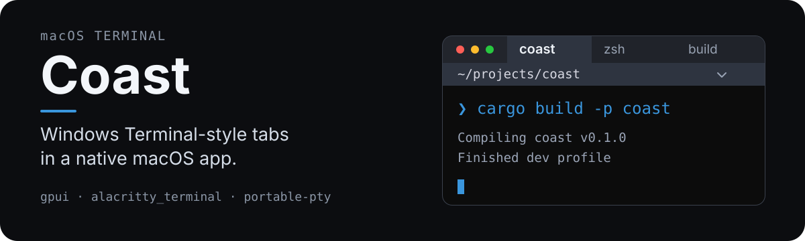

<p align="center">
  
</p>

# Coast

Coast is a native macOS terminal emulator with a Windows Terminal-style tab strip. It draws its own tabs and terminal grid with [gpui](https://www.gpui.rs/), uses [alacritty_terminal](https://github.com/alacritty/alacritty) for VT emulation, and [portable-pty](https://github.com/wez/wezterm) for the shell session.

## Features

- **Windows Terminal-style tabs** — custom-drawn tabs with dividers, hover and active states, scrollable overflow with edge chevrons, and clickable close buttons. New tabs open in the login shell; the active tab shows its directory and, when applicable, the foreground process
- **Native macOS app** — native titlebar and menu bar, an AppKit right-click menu with Copy and Paste, and a `.app` bundle with its own icon (ad-hoc signed, not notarized)
- **Color themes** — eight built-ins: Campbell, One Half Dark/Light, Dracula, Tokyo Night, Catppuccin Mocha, and Solarized Dark/Light. Add your own TOML themes in `~/Library/Application Support/Coast/themes/`, or import a macOS Terminal.app `.terminal` file from the settings page
- **Settings in their own tab** — appearance, UI zoom, font family/size/line spacing, cursor shape/blink/color (native color picker), initial columns and rows, scrollback length, tab-close confirmation, and breadcrumb options. Changes apply live and are saved to disk after a short pause; controls support Tab, arrow-key, Enter/Space and Escape navigation
- **Directory breadcrumb** — an optional clickable path bar that shows the shell's current directory, jumps to an ancestor, or browses into a subdirectory. Long paths collapse to an ellipsis
- **Terminal behavior** — 16 ANSI colors, 256 colors and truecolor; bold, italic, underline, strikethrough and wide characters; bracketed paste; application cursor keys; mouse-wheel scrollback with a macOS-style auto-hiding overlay scrollbar
- **Selection and copy/paste** — drag, double-click word, and triple-click line selection; the native context menu offers Copy when text is selected and Paste when the clipboard holds text
- **Session restore** — open tabs are saved and restored between launches
- **Resize HUD** — a brief `cols × rows` overlay whenever the terminal grid is resized

## Install

There is no installer or prebuilt release yet; building from source is the supported path.

Requirements:

- macOS 12 or later
- Stable Rust and the Xcode command line tools

Build and run the debug binary:

```bash
cargo build -p coast
./target/debug/coast
```

Build a release `.app` bundle and launch it:

```bash
./build.sh
open target/release/bundle/Coast.app
```

`./build.sh` produces `target/release/bundle/Coast.app`. For a debug bundle instead, run `packaging/macos/bundle.sh debug`, then open `target/debug/bundle/Coast.app`.

Run the test suite with `cargo test`.

## Keyboard shortcuts

| Shortcut | Action |
| --- | --- |
| `Cmd-,` | Open Settings |
| `Cmd-T` / `Cmd-W` | New tab / Close tab |
| `Ctrl-Tab` / `Ctrl-Shift-Tab` | Next / previous tab |
| `Cmd-C` / `Cmd-V` | Copy / Paste |
| `Cmd-M` | Minimize |
| `Ctrl-Cmd-F` | Enter full screen |
| `Cmd-H` / `Cmd-Alt-H` | Hide Coast / Hide Others |
| `Cmd-Q` | Quit |

Closing a tab asks for confirmation when it is the last tab or has a foreground process.

## Configuration

User data lives under `~/Library/Application Support/Coast/`:

- `config.toml` — settings
- `themes/`, `chrome-themes/`, `breadcrumb-themes/` — user color, titlebar and breadcrumb themes
- `session.toml` — saved tabs

## Project layout

- `crates/coast` — the application: window and tab management, terminal rendering, settings UI
- `crates/terminal-core` — the PTY and `alacritty_terminal` session layer
- `crates/themes` — built-in themes and `.terminal` import
- `crates/settings` — settings loading and saving

## Author

Built by Russell Dickenson with [Claude](https://claude.com/claude-code).

## License

Coast is licensed under the [GNU General Public License v3.0](LICENSE) or later.
